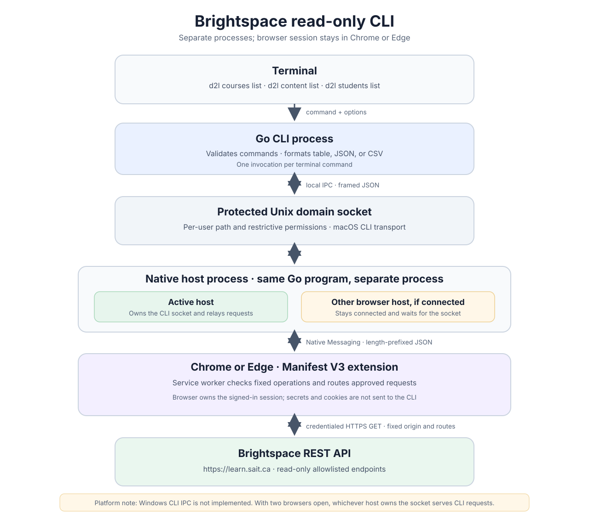

# Brightspace read-only CLI

`d2l` reads selected data from the SAIT Brightspace instance at `https://learn.sait.ca`. The browser extension makes authenticated API requests; a Native Messaging host connects it to the terminal command. The CLI does not ask for a password or copy browser cookies.

This repository supports the **CLI on macOS with Google Chrome or Microsoft Edge**. The Windows CLI bridge and Windows native-host installer are not implemented yet; see [Windows](#windows) below.

## Architecture

The terminal and browser host run as separate processes built from the same Go program. The extension service worker makes fixed, credentialed Brightspace requests; browser cookies stay in the browser. The current process and transport flow is shown below.



## macOS: install and connect Chrome

You need Google Chrome, Go 1.23 or newer, and an account that can sign in to SAIT Brightspace.

1. Open `chrome://extensions`, turn on **Developer mode**, and choose **Load unpacked**. Select the repository's `extension/` directory.
2. On the extension's details page, copy its **ID**. Loading the extension from a different directory can change that ID, so use the ID Chrome currently shows.
3. From the repository root, install the CLI and register the Native Messaging host:

   ```sh
   ./installers/install-chrome-native-host.sh YOUR_32_CHARACTER_EXTENSION_ID
   ```

   For an existing installation managed by this repository, use:

   ```sh
   ./installers/install-chrome-native-host.sh YOUR_32_CHARACTER_EXTENSION_ID --upgrade
   ```

   `--upgrade` verifies the existing installation and saves timestamped backups. The installer refuses to overwrite files it does not recognize.
4. Restart Chrome. Open `https://learn.sait.ca`, sign in, and leave Chrome running. Reload the Brightspace tab after loading or reloading the extension.
5. Open the extension popup and click **Test Native Messaging**. It should report that the host is connected. Then check the CLI:

   ```sh
   ~/.local/bin/d2l status
   ~/.local/bin/d2l whoami
   ```

The installer places `d2l` and `d2l-native-host` in `~/.local/bin/` and registers `~/Library/Application Support/Google/Chrome/NativeMessagingHosts/com.sait.d2l.json`. To use the short `d2l` command in zsh, add `export PATH="$HOME/.local/bin:$PATH"` to `~/.zshrc` and open a new terminal. Otherwise, replace `d2l` in the examples below with `~/.local/bin/d2l`.

## macOS: connect Edge

1. In Edge, open `edge://extensions`, turn on **Developer mode**, and load the same `extension/` directory. Copy the extension ID shown by Edge.
2. Install or upgrade the macOS host with the Chrome procedure above, then register that host for Edge from the repository root:

   ```sh
   ./installers/register-edge-native-host.sh YOUR_EDGE_EXTENSION_ID
   ```

   This registration uses the existing `~/.local/bin/d2l-native-host` executable. Its embedded extension ID must match the Edge ID. If the IDs differ, load the same unpacked extension directory in both browsers; this script will refuse to register a host bound to another ID.
3. Restart Edge, open and sign in to `https://learn.sait.ca`, and click **Test Native Messaging** in the extension popup. The popup should say **Native Messaging host connected**. This connection has been confirmed in both Chrome and Edge.

The Edge manifest is installed at `~/Library/Application Support/Microsoft Edge/NativeMessagingHosts/com.sait.d2l.json`. Chrome and Edge can both keep a Native Messaging connection open. One browser owns the CLI bridge at a time; another connected host waits for the socket to become available. For predictable account selection, keep only the browser session you intend to use open while running CLI commands.

## CLI commands

The examples assume `d2l` is on your `PATH`. All API operations are read-only and use the signed-in Brightspace session in the browser that owns the CLI bridge. Output defaults to a tab-delimited table. Where offered, `--format` accepts `table`, `json`, or `csv`.

| Command | Result |
| --- | --- |
| `d2l status` | Show whether the browser bridge is connected. |
| `d2l whoami` | Show the signed-in Brightspace user's identifier and unique name. |
| `d2l api versions` | Show advertised Brightspace API product versions. |
| `d2l courses list` | Show course `id` and `name` for the current and future calendar terms. |
| `d2l courses list --all` | Include past courses and courses without a recognized term in their names. |
| `d2l courses list --active` | Keep only courses whose API active flag is true. May be combined with `--all`. |
| `d2l content list --course ID` | List root content items in a course, with item ID, title, and type. `ID` must be numeric. |
| `d2l students list --course CODE_OR_ID` | List student ID and name from one course's classlist. |
| `d2l students search NAME` | Search classlists across your current-term courses and show matching student and course details. |

Examples:

```sh
d2l courses list
d2l courses list --all --format csv > courses.csv
d2l courses list --active --format json
d2l content list --course 887055
d2l students list --course 892219
d2l students list --course CPSY-302-B
d2l students list --course cpsy302b
d2l students list --course 302b
d2l students search "Doe, John"
d2l students search "John Doe" --format json
d2l students search John --format csv > matches.csv
```

For `students list`, the course selector can be a numeric Brightspace course ID, a full code such as `CPSY-302-B`, a compact code such as `cpsy302b`, or a short code such as `302b` when it uniquely identifies a course in the current term. January–April is Winter, May–August is Spring, and September–December is Fall. The command tries an exact section first. If that section is absent, an interactive terminal can show other sections and ask you to choose one; it never silently switches sections. In a script, select a numeric ID from `d2l courses list` instead.

`students search` accepts `Last, First`, `First Last`, or a single first or last name. Exact matching ignores order and punctuation and matches whole name tokens. When there are no exact matches, it shows up to 25 similar names, ranked by closeness, and prints a notice to stderr. Output includes student ID, name, course ID, and course name. It searches your current-term course offerings. A student enrolled in multiple matching courses appears once per course. This command may take longer because it reads each current-term classlist.

`courses list` emits only `id` and `name` in table, CSV, and JSON output. `students list` emits `student_id` and `name`; the ID is the nine-digit Brightspace username when available. Course and classlist visibility depend on your Brightspace permissions. Redirected output files may contain student information, so store and share them appropriately.

Run `d2l --help` for a short command summary. Errors go to standard error and failed commands exit with a nonzero status.

## Windows

The Manifest V3 extension can be loaded in Chrome or Edge through `chrome://extensions` or `edge://extensions`. With Developer mode enabled, select **Load unpacked**, choose `extension/`, open an authenticated `https://learn.sait.ca` tab, and use **Run read-only tests** in the popup. Reload a Brightspace tab after loading or updating the extension.

The **terminal CLI is not available on Windows yet**. The current CLI-to-host connection uses a Unix socket; `internal/ipc/ipc_windows.go` returns an unsupported-platform error. This repository has no Windows native-host registration installer. Building the Go executable for Windows does not make `d2l status`, course listing, or student commands work there.

## Troubleshooting

- **`Browser bridge: disconnected`**: Keep Chrome or Edge open on a signed-in Brightspace tab. Check **Test Native Messaging**, then restart that browser and retry. If you updated the source, run the Chrome installer with `--upgrade` and reload the unpacked extension.
- **Native host unavailable**: Confirm that the registered extension ID matches the ID on `chrome://extensions` or `edge://extensions`. The native-host manifest allows that exact extension ID only. On macOS Edge, run `register-edge-native-host.sh` after installing the Chrome host.
- **Sign-in required**: Sign in through Brightspace in the connected browser and retry. The CLI cannot authenticate from a closed browser or import session cookies.
- **Course or classlist access denied**: Use a course you can open in Brightspace. The CLI follows the same account permissions as the browser.
- **Course code ambiguous or missing**: Use `d2l courses list` to find the numeric course ID, then pass it to `--course`.

## Scope and further documentation

The extension accepts fixed, read-only operations and the CLI cannot provide an arbitrary URL or HTTP method. Data Hub exports are **not** a CLI command in this version. Details of the implemented routes and their behavior are in [M4 read-only operations](docs/m4-read-only-operations.md); the broader roadmap is in the [development plan](d2l-cli-development-plan.md).
